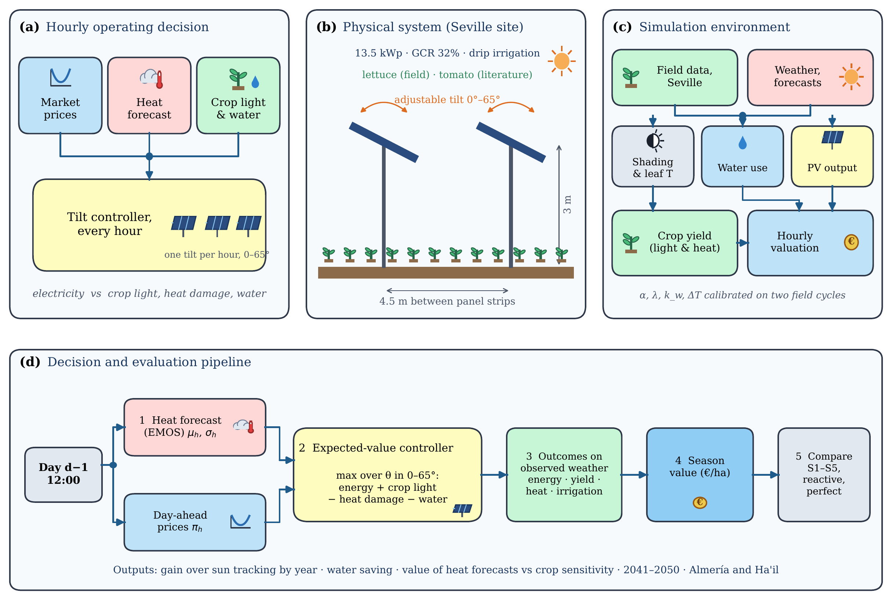
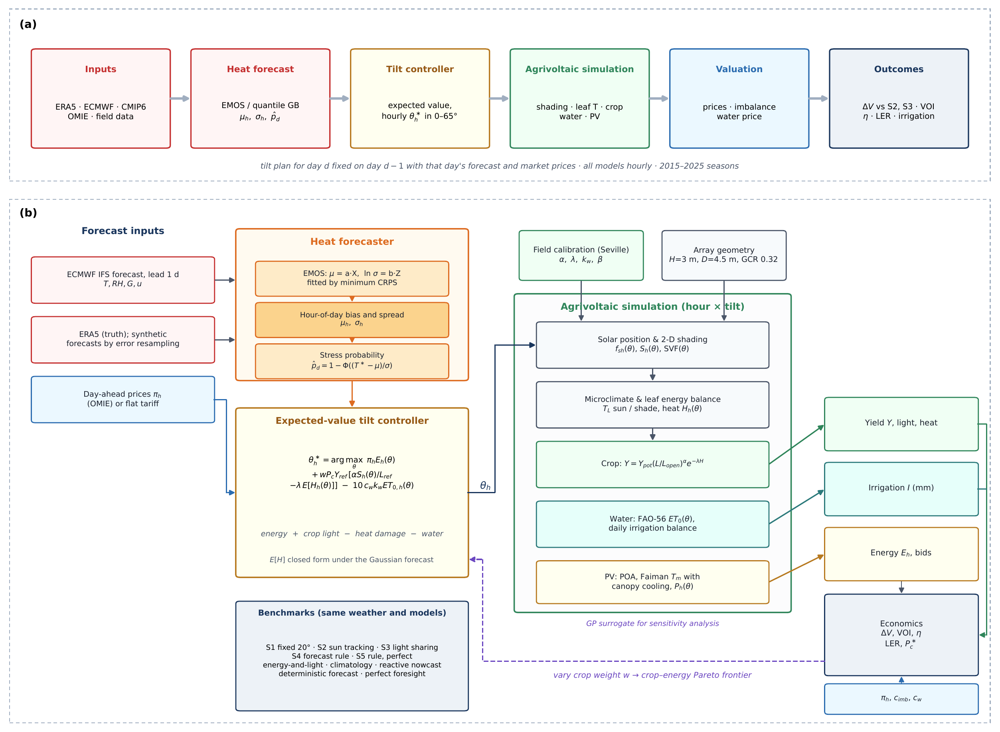

# Price-aware operation of tilt-adjustable agrivoltaic systems

Code and data accompanying the paper *"The economic value of price-aware operation in agrivoltaic systems: Electricity prices, crop heat protection and water savings across climates"* by Ahlem Ferchichi et al. (submitted).

  

## Introduction

Agrivoltaic (APV) systems share the same land between crops and solar panels. When the panel tilt can be changed every hour, the operator must decide at each moment whether to favour electricity, crop light or crop protection from heat. This repository provides an open framework that makes this decision hourly and values it in euros per hectare.

The framework links two-dimensional shading, PV generation with canopy cooling, a leaf energy balance, crop light and heat responses, crop water use, probabilistic heat forecasts (EMOS and quantile gradient boosting, QGB) and real day-ahead electricity prices in an expected-value tilt controller. It is calibrated on an elevated APV lettuce experiment near Seville (Spain), evaluated over eleven seasons (2015–2025), transferred to Almería (Spain) and Ha'il (Saudi Arabia), and projected to 2041–2050 with three CMIP6 models.

**Main findings**

- **Electricity prices decide the value of moving the panels.** Price-aware control earned the same as sun tracking in 2015–2022 but gained 57, 348 and 578 €/ha per season in 2023, 2024 and 2025, as Spanish midday prices fell from 66 to 15 €/MWh.
- **Heat forecasts pay only for heat-sensitive, high-value crops.** For lettuce they added no value; for fresh-market tomato they added up to 193 €/ha per season.
- **Water savings come from the installation, not its operation.** The panels cut irrigation by about 22 % (model) to 35–36 % (field), while optimising the tilt for water added less than 1 €/ha.

## Model

  

**(a)** Each day *d − 1*, the tilt plan for day *d* is fixed using that day's heat forecast and day-ahead prices. **(b)** Detailed architecture:

1. **Heat forecaster.** ECMWF IFS forecasts are post-processed by EMOS or QGB into an hourly temperature mean and spread (μh, σh) and a stress-day probability.
2. **Expected-value tilt controller.** For every hour it chooses the tilt θ\*h ∈ [0°, 65°] that maximises electricity revenue + crop light − expected heat damage − water cost.
3. **Agrivoltaic simulation.** Solar position and 2-D shading, microclimate and leaf energy balance, crop yield *Y = Ypot(L/Lopen)α e−λH*, FAO-56 water balance and PV output with canopy cooling.
4. **Valuation.** Season value in €/ha (electricity − imbalance cost + crop − water), compared with fixed tilt, sun tracking, light sharing, forecast rules, reactive control and perfect foresight.
